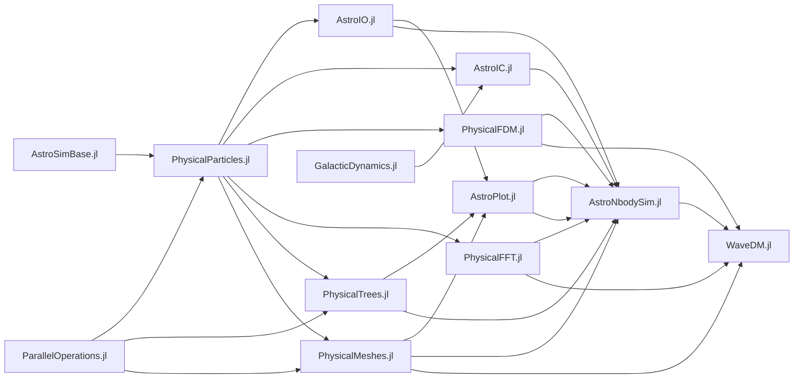

# AstroNbodySim.jl

[](https://codecov.io/gh/JuliaAstroSim/AstroNbodySim.jl)
[![][docs-dev-img]][docs-dev-url]

This is an astrophysical simulation code library under GPL 3.0

[中文Readme](https://github.com/JuliaAstroSim/AstroNbodySim.jl/blob/master/README中文.md)

## Documentation

- [**Dev**][docs-dev-url] &mdash; *documentation of the in-development version.*

[docs-dev-img]: https://img.shields.io/badge/docs-dev-blue.svg
[docs-dev-url]: https://juliaastrosim.github.io/AstroNbodySim.jl/dev

For beginners, it is highly recommended to read the [documentation of PhysicalParticles.jl](https://juliaastrosim.github.io/PhysicalParticles.jl/dev/).

## Installation

```julia
]add AstroNbodySim
```
or
```julia
]add https://github.com/JuliaAstroSim/AstroNbodySim.jl
```

**You might need to install [NVIDIA CUDA toolkit](https://developer.nvidia.com/cuda-toolkit)**

## Package Features

- Compute with units
- User-friendly
  - Well documented
  - Readable programming
  - Vectorized array operations
  - Dispatch on types for various simulation settings
  - Float16, Float32, Float64, Int128, BigFloat, Measurement, etc.
- Cross-platform: Linux, Windows, MacOS. Easy to deploy
- Hybrid Parallelism: multi-threading, distributed parallelism, GPU acceleration
- Modularity and Versatility: 9 packages, designed for general purposes, highly extentable
- Realtime visualzation (interactive)
- Auto-test workflow

## Features quick view

### Realtime visualization of simulations on GPU


### Galactic collision


### Uncertainty propagation


### Autodiff of background potential field


### User-difined pipeline: Tidal disruption event (TDE)

Position slices:


Accretion history:


### Lagrange radii and scale radius


### Solar System


### Trajectory lookback


## Supporting and Citing

This software was developed as part of academic research. If you use it in
research, teaching, or other activities, please cite the package repository
together with the version/commit you used, and cite the following papers.

`AstroNbodySim.jl` is the N-body engine of
[WaveDM.jl](https://github.com/JuliaAstroSim/WaveDM.jl):

- **Meng, R. & Dong, X. 2026**, *WaveDM.jl: An Adaptable Simulation Framework for Dynamics of Baryonic and Wave Dark Matter on Galaxy Scales*, Research in Astronomy and Astrophysics — [journal article](http://iopscience.iop.org/article/10.1088/1674-4527/ae9042) · [arXiv:2606.25026](https://arxiv.org/abs/2606.25026) · DOI [10.1088/1674-4527/ae9042](https://doi.org/10.1088/1674-4527/ae9042)

```bibtex
@article{meng2026wavedmjladaptablea,
  title = {{{WaveDM}}.Jl: {{An Adaptable Simulation Framework}} for {{Dynamics}} of {{Baryonic}} and {{Wave Dark Matter}} on {{Galaxy Scales}}},
  shorttitle = {{{WaveDM}}.Jl},
  author = {Meng, Runyu and Dong, Xiaobo},
  year = 2026,
  journal = {Research in Astronomy and Astrophysics},
  issn = {1674-4527},
  doi = {10.1088/1674-4527/ae9042},
  url = {http://iopscience.iop.org/article/10.1088/1674-4527/ae9042},
  eprint = {2606.25026},
  archiveprefix = {arXiv},
  primaryclass = {astro-ph.GA},
  urldate = {2026-07-26}
}
```

Publications built on this code base:

- **Meng, R. & Dong, X. 2026**, *Wave Cold Dark Matter Can Reproduce the Radial Acceleration Relation in X-ray Elliptical Galaxies*, Research in Astronomy and Astrophysics — [journal article](http://iopscience.iop.org/article/10.1088/1674-4527/aeac08) · [arXiv:2610.18969](https://arxiv.org/abs/2610.18969) · DOI [10.1088/1674-4527/aeac08](https://doi.org/10.1088/1674-4527/aeac08)

```bibtex
@article{meng2026wavecold,
  title = {Wave {{Cold Dark Matter Can Reproduce}} the {{Radial Acceleration Relation}} in {{X}}-Ray {{Elliptical Galaxies}}},
  author = {Meng, Runyu and Dong, Xiaobo},
  year = 2026,
  journal = {Research in Astronomy and Astrophysics},
  issn = {1674-4527},
  doi = {10.1088/1674-4527/aeac08},
  url = {http://iopscience.iop.org/article/10.1088/1674-4527/aeac08},
  eprint = {2610.18969},
  archiveprefix = {arXiv},
  primaryclass = {astro-ph.GA},
  urldate = {2026-09-24}
}
```

Methodological references for the gravity solvers are listed on the
[CITING page](https://juliaastrosim.github.io/AstroNbodySim.jl/dev/citation/).
BibTeX entries are also available in [`CITATION.bib`](CITATION.bib).

## FAQ

## Package ecosystem



- Basic data structure: [PhysicalParticles.jl](https://github.com/JuliaAstroSim/PhysicalParticles.jl)
- File I/O: [AstroIO.jl](https://github.com/JuliaAstroSim/AstroIO.jl)
- Initial Condition: [AstroIC.jl](https://github.com/JuliaAstroSim/AstroIC.jl)
- Parallelism: [ParallelOperations.jl](https://github.com/JuliaAstroSim/ParallelOperations.jl)
- Trees: [PhysicalTrees.jl](https://github.com/JuliaAstroSim/PhysicalTrees.jl)
- Meshes: [PhysicalMeshes.jl](https://github.com/JuliaAstroSim/PhysicalMeshes.jl)
- Plotting: [AstroPlot.jl](https://github.com/JuliaAstroSim/AstroPlot.jl)
- Simulation: [AstroNbodySim](https://github.com/JuliaAstroSim/AstroNbodySim.jl)
- Benchmark: [BenchmarkPlots](https://github.com/JuliaAstroSim/BenchmarkPlots.jl)
- Parameter space exploration: [ParameterSpace](https://github.com/JuliaAstroSim/ParameterSpace.jl)